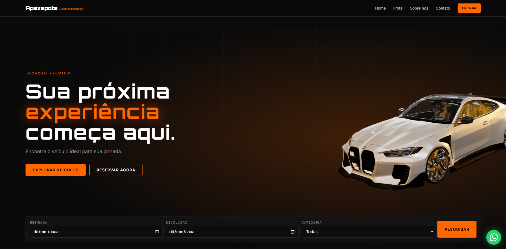

# 🧡 ApexSports Locadora

### Sua próxima experiência começa ao volante.

O **ApexSports Locadora** é um projeto de landing page desenvolvido para uma locadora de veículos premium, oferecendo uma experiência moderna, tecnológica e intuitiva para apresentação e aluguel de automóveis. Com uma identidade visual inspirada no universo automotivo, utilizando preto e laranja como cores predominantes, a plataforma apresenta uma frota diversificada, visualizações 3D, filtros de veículos e um fluxo demonstrativo de reservas.

## 🌐 Demonstração

🔗 **Acesse o projeto online:** https://shwnzzzz.github.io/Apexsports_Locadora-ProjectShw/

## ✨ Funcionalidades

- 🏎️ Página inicial com destaque para veículos premium.
- 🚘 Catálogo de veículos com diferentes categorias.
- 🔍 Filtros por categoria, preço e disponibilidade.
- 🎮 Visualização 3D de veículos com Three.js.
- 📋 Página de detalhes com especificações dos automóveis.
- 📅 Calendário para seleção de datas de reserva.
- 💰 Cálculo estimado do valor da locação.
- 🔐 Sistema demonstrativo de cadastro e login.
- 👤 Área do cliente com histórico de reservas.
- 📲 Formulário de contato integrado ao WhatsApp.
- 📱 Layout responsivo para dispositivos móveis.
- ⚡ Animações e efeitos visuais com GSAP.

## 🛠️ Tecnologias utilizadas

- HTML5
- CSS3
- JavaScript
- Three.js
- GSAP
- ScrollTrigger
- Google Fonts
- LocalStorage

## 🎯 Objetivo do projeto

O ApexSports Locadora foi desenvolvido como projeto de portfólio, com o objetivo de colocar em prática conhecimentos de desenvolvimento web, programação JavaScript, criação de interfaces responsivas e princípios de UI/UX Design. O projeto também explora recursos de visualização tridimensional, animações interativas e funcionalidades demonstrativas de uma plataforma de locação de veículos, proporcionando uma experiência digital mais imersiva e próxima de um serviço real.

## ⚙️ Observações técnicas

O projeto é um protótipo front-end e utiliza o armazenamento local do navegador (`localStorage`) para registrar contas, sessões e reservas demonstrativas.
Não possui integração com banco de dados, autenticação segura ou processamento real de pagamentos.

## 👨‍💻 Desenvolvedor

**ShwDevs** Desenvolvimento de Software | UI/UX Design | Desenvolvimento Mobile

---

  Desenvolvido com 🧡 por <strong>ShwDevs</strong>
   
  <strong>ApexSports Locadora — Potência, sofisticação e liberdade em cada viagem.</strong>

